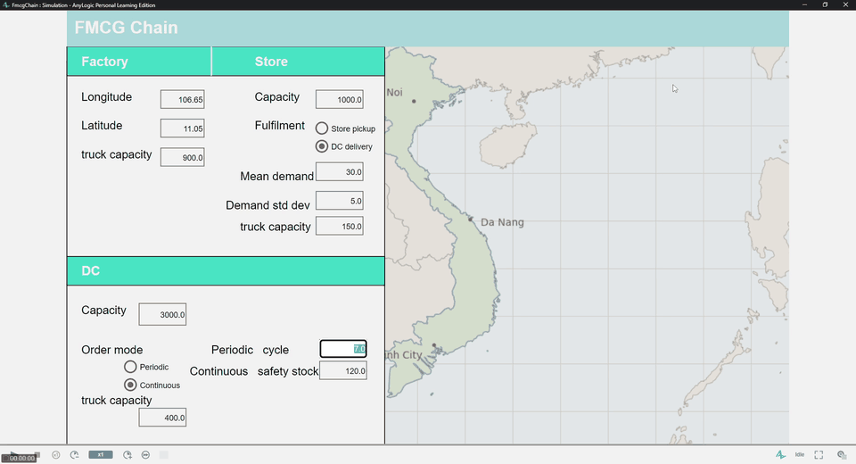
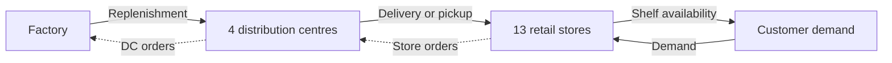

# FMCG Three-Echelon Supply Chain: An Agent-Based Simulation

<p align="center">
  <strong>01 factory &nbsp;→&nbsp; 04 distribution centres &nbsp;→&nbsp; 13 retail stores</strong><br>
  <sub>Vietnam · AnyLogic 8.7 · 180-day simulation</sub>
</p>

<p align="center">
  <a href="README.md">English</a> · <a href="docs/README.vi.md">Tiếng Việt</a> · <a href="#running-the-model">Run the model</a> · <a href="#policy-comparison">Compare policies</a>
</p>

<p align="center">
  
</p>

> [!NOTE]
> The animation shows the model in action. It is a demonstration, not evidence of performance for any particular policy.

## Overview

This repository documents an agent-based simulation of a fast-moving consumer goods (FMCG) supply chain. In an agent-based simulation, each factory, distribution centre (DC) and store follows its own rules, and their interactions shape the results. The primary artefact is an AnyLogic 8.7 project representing one factory, four DCs and thirteen retail stores in Vietnam. The model covers store demand, shelf availability, lost sales, replenishment decisions, DC inventory, transport and cumulative service metrics.

The project treats a supply chain as an interconnected system rather than a set of independent functions. Decisions made at a store affect orders placed on a DC; review rules and transport capacity then determine how that demand reaches the factory. This system view follows the tradition of industrial dynamics and system dynamics, where structure and timing generate behaviour over time (Forrester, 1961; Sterman, 2000).



## Why the model was developed

A single service percentage does not explain where service fails. A DC may fulfil most retailer orders while customers still encounter empty shelves because stock is delayed in transit or held at the wrong node. Conversely, a high store fill rate may depend on inventory levels that are costly to hold or difficult to sustain.

The model was therefore developed to make these relationships observable. It converts broad supply-chain questions into explicit assumptions, controllable parameters and measurable outcomes:

- Where does demand fail to become a sale: at the store, at the DC, or in transport?
- Does continuous review outperform periodic review once inventory and lead time are represented together?
- Does DC delivery or store pickup provide better service under the same network and demand conditions?
- What is the inventory required to support a given level of shelf availability?
- How do weekly demand patterns and promotions change the behaviour of a replenishment policy?

## Model scope

| Element | Representation |
| --- | --- |
| Network | One factory, four DCs, thirteen stores on a Vietnamese GIS network |
| Product | One aggregate product flow |
| Horizon | Length of one run: 180 days, equivalent to 4,320 model hours |
| Random seed | Fixed at 1 so the same random demand pattern repeats in every baseline run |
| Demand | Daily store demand that varies by weekday and rises during promotions |
| Store inventory | Shelf stock replenished toward a cover target; unmet demand becomes lost sales, not a backorder |
| DC inventory | Stock holding and pending orders; the DC reviews stock either on a fixed schedule or whenever it falls below a threshold |
| Transport | Capacity-limited trucks; split loads and sequential trips |
| Outputs | Fill rate, DC order service, lost sales, overflow and completed-order lead time |

Horizon and seed are simulation controls: the horizon says how long the model runs, and the seed says which random demand pattern it draws. `Order-up-to` means ordering enough to bring expected stock back up to a target, here based on the store's cover days.

The network is loaded from `Wholesalers.xlsx` and `Retailers.xlsx`. Each row creates one agent, which allows the network structure to be changed without rewriting the agent logic.

## Policy comparison

Two decisions form the main 2×2 experiment:

| Parameter | Value 0 | Value 1 |
| --- | --- | --- |
| `orderModeOfWholesaler` | Periodic: DC checks stock on a schedule | Continuous: DC checks stock against a reorder threshold |
| `takeModeOfRetailer` | Store pickup (pull) | DC delivery (push) |

In the AnyLogic `Simulation` experiment, change these two inputs in the parameter panel and start a fresh run for each of the four combinations. Keep the seed, run length and network unchanged. The experiment settings also expose the same input names if you want to set their initial values before running.

All four combinations should be run with the same seed, horizon and network. This holds demand realisations constant so that differences in service and inventory can be attributed to policy structure rather than to different input samples. Even then, one seed supports an illustration, not a general conclusion. Replicated runs over multiple seeds are required before treating a difference as statistically meaningful.

The push–pull distinction matters because it determines where variability is buffered and who controls replenishment timing. Inventory and replenishment policies exist to decouple supply from demand, but that decoupling has costs and response-time consequences (Chopra and Meindl, 2016). Information delay and local decision rules can also amplify variability across echelons, a phenomenon associated with the bullwhip effect (Lee *et al.*, 1997).

## Performance measures

The model separates service measures by decision owner:

- **Store fill rate** = `servedDemand / demandTotal`. This measures what the customer experiences.
- **DC order service** = `(numOfOrderOfRetailer - numOfUnfulfilledOrder) / numOfOrderOfRetailer`. This is the share of store orders fully covered by DC stock when the order arrives. A partially shipped order still counts as unfulfilled; a later delivery does not change that count.
- **Lost sales** = demand that could not be served from the shelf.
- **Completed-order lead time** = elapsed time between a store order and its completed receipt.
- **Overflow** = stock that cannot be accepted at a DC or store.

The measures are intentionally not merged. A high DC order-service value does not guarantee a high store fill rate, and a high fill rate may conceal excess inventory, waste or frequent emergency replenishment. Where a denominator is zero, the KPI is shown as `N/A` rather than as a misleading zero.

The charts display a rolling 100-hour window for readability. This is a visualisation window and is not the simulation horizon.

## Running the model

1. Open AnyLogic 8.7.x.
2. Select `File → Open` and choose `anylogic/fscc/FmcgChain.alp`.
3. In `Main`, inspect the database-backed `retailer` and `wholesaler` populations: they should create thirteen and four agents, respectively.
4. Select the `Simulation` experiment.
5. Confirm a stop time of 180 days or 4,320 hours and seed `1`.
6. Build the model and run the experiment.

The AnyLogic GIS basemap uses online map tiles, and the configured routing also queries an online provider. Internet access is therefore needed for the basemap and for road routes; when routing is unavailable, the model falls back to straight-line paths. This fallback changes travel distances and times, so offline results should not be treated as equivalent.

<details>
<summary><strong>Explore the repository structure</strong></summary>

Required files for the core AnyLogic model:

```text
anylogic/fscc/
├── FmcgChain.alp
├── Wholesalers.xlsx
├── Retailers.xlsx
├── map.png
├── database/
│   ├── db.script
│   └── db.properties
└── 3d/
    ├── factory_2.dae
    ├── warehouse.dae
    ├── store.dae
    └── truck.dae
```

Supporting material:

```text
config/                     Scenario and network configuration for the Python twin
fmcg_sim/                   Headless Python implementation
docs/anylogic-build.md      Model specification and implementation notes
tools/                      XML generation and map utilities
tests/                      Model and presentation checks
```

The Python implementation is useful for exploring scenarios and documenting logic in a readable form. It is not assumed to produce numerically identical results to the AnyLogic model: the two implementations differ in modelling conventions, aggregation and transport behaviour. Cross-checks are therefore made at the level of definitions and accounting identities rather than by forcing a superficial numerical match.

</details>

## Supply-chain reasoning represented in the project

- **Separating symptoms from causes.** Lost sales, unfulfilled orders and long lead times are recorded separately because they can have different causes.
- **Treating inventory as a decision, not a static quantity.** Safety stock (extra stock kept against uncertainty), cover days (how many days of expected demand to hold) and review timing are inputs that can be changed and compared.
- **Respecting physical constraints.** Truck capacity and travel time are part of service performance; replenishment cannot be evaluated as if transport were instantaneous.
- **Comparing policies under controlled conditions.** Seed, horizon and network are held constant across policy configurations.
- **Checking accounting consistency.** Served plus lost demand should equal total demand; fulfilled plus unfulfilled orders should equal total orders.
- **Distinguishing interpretation from presentation.** Chart layout and label clarity affect whether the results can be read correctly, but visual changes are not treated as changes to model logic.
- **Stating model boundaries.** The simulation supports structured comparison; it does not estimate real demand parameters or optimise total cost.

<details>
<summary><strong>Limitations and further work</strong></summary>

The present AnyLogic model uses one aggregate product flow. Shelf-life expiry, FIFO batch issuing, multi-SKU substitution and shared vehicle routing are not yet implemented in the AnyLogic model. The results are therefore suitable for studying structural relationships between replenishment, inventory, transport and service, but not for making SKU-level assortment or pricing decisions.

Natural extensions are:

- batch-level shelf life and FIFO issuing;
- SKU segmentation by demand variability and value;
- cost parameters for holding, write-off, emergency transport and lost sales;
- repeated-seed experiments with confidence intervals;
- comparison against historical demand and lead-time data.

</details>

<details>
<summary><strong>References</strong></summary>

Chopra, S. and Meindl, P. (2016) *Supply Chain Management: Strategy, Planning, and Operation*. 6th edn. Harlow: Pearson.

Forrester, J.W. (1961) *Industrial Dynamics*. Cambridge, MA: MIT Press.

Lee, H.L., Padmanabhan, V. and Whang, S. (1997) 'Information distortion in a supply chain: the bullwhip effect', *Management Science*, 43(4), pp. 546–558.

Sterman, J.D. (2000) *Business Dynamics: Systems Thinking and Modeling for a Complex World*. Boston, MA: Irwin/McGraw-Hill.

</details>

---

[Tiếng Việt →](docs/README.vi.md)
