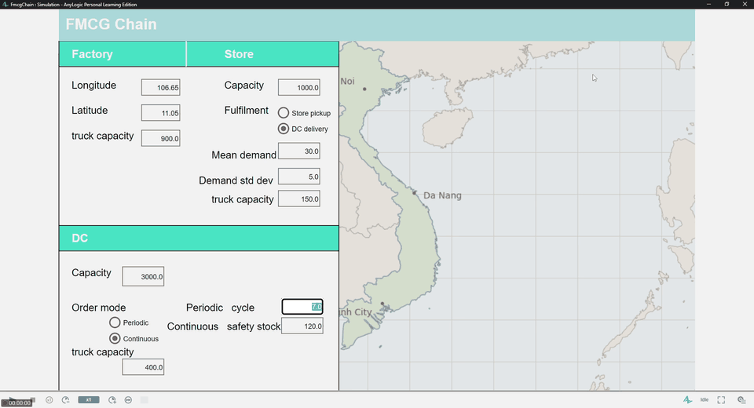

# Mô phỏng chuỗi cung ứng FMCG ba tầng bằng mô hình agent-based

<p align="center">
  <strong>01 nhà máy &nbsp;→&nbsp; 04 trung tâm phân phối &nbsp;→&nbsp; 13 cửa hàng</strong><br>
  <sub>Việt Nam · AnyLogic 8.7 · mô phỏng 180 ngày</sub>
</p>

<p align="center">
  <a href="../README.md">English</a> · <a href="README.vi.md">Tiếng Việt</a> · <a href="#chạy-mô-hình">Chạy mô hình</a> · <a href="#so-sánh-chính-sách">So sánh chính sách</a>
</p>

<p align="center">
  
</p>

> [!NOTE]
> Đoạn hoạt hình thể hiện mô hình đang chạy; đây là minh họa, không phải bằng chứng về hiệu quả của một chính sách cụ thể.

## Tổng quan

Tài liệu này giới thiệu mô hình mô phỏng chuỗi cung ứng hàng tiêu dùng nhanh (FMCG) theo hướng agent-based: mỗi nhà máy, trung tâm phân phối (DC) và cửa hàng là một tác nhân có quy tắc hoạt động riêng; kết quả hình thành từ cách các tác nhân tương tác. Sản phẩm chính là project AnyLogic 8.7 gồm một nhà máy, bốn DC và mười ba cửa hàng tại Việt Nam. Mô hình theo dõi nhu cầu tại cửa hàng, hàng có sẵn trên kệ, nhu cầu không được đáp ứng (mất bán), quyết định bổ sung, tồn kho tại DC, vận chuyển và các chỉ số dịch vụ tích lũy.

Project tiếp cận chuỗi cung ứng như một hệ thống liên kết, không phải tập hợp các chức năng độc lập. Quyết định tại cửa hàng tạo ra đơn hàng cho DC; quy tắc kiểm tồn và năng lực vận chuyển tiếp đó quyết định cách nhu cầu truyền ngược về nhà máy. Cách nhìn này phù hợp với tư duy industrial dynamics và system dynamics, trong đó cấu trúc và độ trễ của hệ thống tạo ra hành động theo thời gian (Forrester, 1961; Sterman, 2000).


## Lý do xây dựng project

Một tỷ lệ dịch vụ duy nhất chưa đủ để giải thích vì sao dịch vụ chưa đạt. DC có thể đáp ứng phần lớn đơn của cửa hàng, nhưng khách vẫn gặp kệ trống vì hàng bị chậm trên đường hoặc đang tồn ở một nút khác. Ngược lại, tỷ lệ đáp ứng nhu cầu (fill rate) cao tại cửa hàng có thể phải trả giá bằng mức tồn lớn, lãng phí hoặc bổ sung khẩn cấp thường xuyên.

Vì vậy, project được xây dựng để làm rõ các quan hệ đó. Những câu hỏi chung về chuỗi cung ứng được chuyển thành giả định, tham số có thể điều chỉnh và chỉ số có thể đo lường:

- Nhu cầu không chuyển thành doanh thu ở đâu: cửa hàng, DC hay khâu vận chuyển?
- Kiểm tồn liên tục có hiệu quả hơn kiểm tồn định kỳ khi xét cùng lúc tồn kho và thời gian chờ hàng (lead time) không?
- Giao hàng từ DC hay cửa hàng tự lấy hàng mang lại dịch vụ tốt hơn trong cùng điều kiện mạng lưới và nhu cầu?
- Cần mức tồn kho nào để duy trì một mức sẵn có nhất định trên kệ?
- Nhu cầu thay đổi theo ngày trong tuần và khuyến mãi làm chính sách bổ sung phản ứng ra sao?

## Phạm vi mô hình

| Thành phần | Cách biểu diễn |
| --- | --- |
| Mạng lưới | 1 nhà máy, 4 DC, 13 cửa hàng trên bản đồ GIS Việt Nam |
| Sản phẩm | Một dòng hàng tổng hợp |
| Thời gian mô phỏng | Thời lượng một lần chạy: 180 ngày, tương đương 4.320 giờ mô hình |
| Seed | Giá trị khởi tạo của bộ sinh ngẫu nhiên, cố định là 1 để tái lập cùng một chuỗi nhu cầu |
| Nhu cầu | Nhu cầu ngày tại cửa hàng, thay đổi theo ngày trong tuần và tăng khi có khuyến mãi |
| Tồn cửa hàng | Hàng trên kệ được bổ sung về mức tồn mục tiêu; phần nhu cầu thiếu được tính là mất bán, không ghi đơn chờ (backorder) |
| Tồn DC | Tồn kho và các đơn chờ xử lý; DC kiểm tồn theo lịch cố định hoặc mỗi khi tồn xuống dưới ngưỡng |
| Vận chuyển | Xe có giới hạn tải trọng; tách chuyến và xử lý tuần tự |
| Kết quả | Fill rate, dịch vụ đơn DC, nhu cầu mất bán, hàng tràn, lead time đơn hoàn tất |

Thời gian mô phỏng và seed là hai nút điều khiển: một quy định lần chạy kéo dài bao lâu, một quy định chuỗi nhu cầu ngẫu nhiên nào được dùng. "Bổ sung về mức tồn mục tiêu" nghĩa là đặt hàng để đưa tồn kho về một mức đã đặt trước, ở đây dựa trên số ngày tồn (cover days) của cửa hàng.

Mạng lưới được nạp từ `Wholesalers.xlsx` và `Retailers.xlsx`. Mỗi dòng tạo một agent, nên có thể thay đổi cấu trúc mạng lưới mà không sửa logic của agent.

## So sánh chính sách

Hai quyết định tạo thành thí nghiệm 2×2:

| Tham số | Giá trị 0 | Giá trị 1 |
| --- | --- | --- |
| `orderModeOfWholesaler` | DC kiểm tồn định kỳ theo lịch | DC kiểm tồn liên tục theo ngưỡng đặt thêm |
| `takeModeOfRetailer` | Cửa hàng tự lấy hàng (pull) | DC giao hàng (push) |

Trong thí nghiệm `Simulation` của AnyLogic, đổi hai tham số này ở bảng nhập tham số rồi bắt đầu một lần chạy mới cho từng tổ hợp trong bốn tổ hợp. Giữ nguyên seed, thời gian mô phỏng và mạng lưới. Bạn cũng có thể đặt giá trị ban đầu của chúng trong phần cài đặt thí nghiệm trước khi chạy.

Bốn tổ hợp cần được chạy với cùng seed, cùng thời gian mô phỏng và cùng mạng lưới. Cách này giữ cố định chuỗi nhu cầu ngẫu nhiên, giúp phân biệt tác động của cấu trúc chính sách với tác động của đầu vào khác nhau. Tuy nhiên, một seed chỉ đủ để minh họa. Muốn kết luận chung cần lặp nhiều seed và xét khoảng tin cậy.

Trong lựa chọn push–pull, ai giao hàng và ai quyết định thời điểm lấy hàng sẽ quyết định nơi phải giữ hàng dự phòng. Tồn kho giúp giảm tác động của biến động cung cầu, nhưng phải trả bằng chi phí và thời gian phản ứng (Chopra and Meindl, 2016). Thông tin đến chậm và quyết định riêng ở từng tầng cũng có thể khiến biến động nhu cầu bị khuếch đại khi truyền ngược lên chuỗi cung ứng, gọi là hiệu ứng roi (Lee *et al.*, 1997).

## Chỉ số đánh giá

Mô hình tách các chỉ số dịch vụ theo đối tượng chịu trách nhiệm:

- **Fill rate tại cửa hàng** = `servedDemand / demandTotal`; tỷ lệ nhu cầu khách hàng được phục vụ ngay trên kệ.
- **Dịch vụ đơn tại DC** = `(numOfOrderOfRetailer - numOfUnfulfilledOrder) / numOfOrderOfRetailer`; tỷ lệ đơn cửa hàng được đáp ứng đúng số lượng từ tồn kho sẵn có khi đơn đến. Đơn giao một phần vẫn được tính là không đáp ứng đúng, dù phần còn lại được giao sau.
- **Mất bán (lost sales)** = số lượng nhu cầu khách hàng không được phục vụ từ tồn kệ. Đây là số lượng hàng, không phải số đơn.
- **Lead time đơn hoàn tất** = thời gian từ lúc cửa hàng đặt đến lúc nhận đủ hàng.
- **Hàng tràn** = hàng không thể tiếp nhận tại DC hoặc cửa hàng.

Các chỉ số này không được gộp với nhau. Dịch vụ đơn tại DC cao chưa chắc dẫn đến fill rate cao tại cửa hàng; fill rate cao cũng có thể che giấu tồn kho dư, hàng hủy hoặc bổ sung khẩn cấp. Khi mẫu số bằng 0, KPI hiển thị `N/A` thay vì số 0 gây hiểu nhầm.

Biểu đồ dùng cửa sổ 100 giờ để dễ quan sát. Đây là cửa sổ hiển thị, không phải thời hạn mô phỏng.

## Chạy mô hình

1. Mở AnyLogic 8.7.x.
2. Chọn `File → Open` và mở `anylogic/fscc/FmcgChain.alp`.
3. Trong `Main`, kiểm tra hai nhóm tác nhân `retailer` và `wholesaler` được nạp từ database: lần lượt phải tạo đủ mười ba và bốn tác nhân.
4. Chọn experiment `Simulation`.
5. Xác nhận stop time là 180 ngày hoặc 4.320 giờ và seed là `1`.
6. Build mô hình và chạy experiment.

Bản đồ GIS của AnyLogic dùng online tile, còn tuyến đường được cấu hình để truy vấn dịch vụ trực tuyến. Cần kết nối internet để thấy nền bản đồ và lấy tuyến đường thực tế; khi không có tuyến, mô hình rơi về đường thẳng. Đường thẳng làm quãng đường và thời gian di chuyển khác đi, nên kết quả chạy offline không nên xem là tương đương.

<details>
<summary><strong>Xem cấu trúc repository</strong></summary>

Các file bắt buộc của project AnyLogic core:

```text
anylogic/fscc/
├── FmcgChain.alp
├── Wholesalers.xlsx
├── Retailers.xlsx
├── map.png
├── database/
│   ├── db.script
│   └── db.properties
└── 3d/
    ├── factory_2.dae
    ├── warehouse.dae
    ├── store.dae
    └── truck.dae
```

Tài liệu và công cụ hỗ trợ:

```text
config/                     Cấu hình kịch bản và mạng lưới cho bản Python
fmcg_sim/                   Cài đặt mô phỏng headless bằng Python
docs/anylogic-build.md      Đặc tả mô hình và ghi chú triển khai
tools/                      Công cụ sinh XML và bản đồ
tests/                      Kiểm tra mô hình và bố cục giao diện
```

Bản Python hữu ích cho việc khám phá kịch bản và mô tả logic dưới dạng dễ đọc. Không giả định bản Python và bản AnyLogic cho cùng con số: hai bản khác nhau về cách mô hình hóa, cách tổng hợp và cách vận chuyển. Khi đối chiếu, nên kiểm tra xem hai bản đo cùng một chỉ số theo cùng định nghĩa và các tổng có khớp nhau hay không, thay vì buộc kết quả số học phải giống hệt.

</details>

## Tư duy supply chain được thể hiện qua project

- **Tách triệu chứng và nguyên nhân.** Mất bán, đơn DC không đáp ứng và lead time dài được ghi nhận riêng vì chúng có thể có nguyên nhân khác nhau.
- **Xem tồn kho như một quyết định.** Tồn đệm (safety stock), số ngày tồn (cover days) và thời điểm kiểm tồn là đầu vào có thể thay đổi và so sánh.
- **Tôn trọng ràng buộc vật lý.** Tải trọng xe và thời gian di chuyển là một phần của dịch vụ; không thể đánh giá bổ sung như thể vận chuyển là tức thì.
- **So sánh chính sách trong điều kiện kiểm soát.** Seed, thời gian mô phỏng và mạng lưới được giữ cố định giữa các cấu hình.
- **Kiểm tra cân bằng số liệu.** Hàng bán cộng nhu cầu mất bán phải bằng tổng nhu cầu; đơn đáp ứng cộng đơn không đáp ứng phải bằng tổng đơn.
- **Phân biệt diễn giải kết quả và trình bày kết quả.** Bố cục biểu đồ và độ rõ nhãn ảnh hưởng đến cách đọc kết quả, nhưng thay đổi thị giác không được xem là thay đổi logic mô hình.
- **Nêu rõ ranh giới mô hình.** Mô phỏng hỗ trợ so sánh có cấu trúc; nó không ước lượng tham số nhu cầu thực tế và không tối ưu tổng chi phí.

<details>
<summary><strong>Hạn chế và hướng phát triển</strong></summary>

Mô hình hiện tại dùng một dòng hàng tổng hợp. Hạn sử dụng theo lô, xuất FIFO, đa SKU và điều phối xe dùng chung chưa được triển khai trong bản AnyLogic. Kết quả vì vậy phù hợp để nghiên cứu quan hệ giữa bổ sung, tồn kho, vận chuyển và dịch vụ, chưa phù hợp để ra quyết định danh mục hay giá theo từng SKU.

Các hướng mở rộng tự nhiên:

- tồn theo lô với hạn sử dụng và xuất FIFO;
- phân khúc SKU theo độ biến động nhu cầu và giá trị;
- thêm chi phí tồn kho, hàng hủy, vận chuyển khẩn và nhu cầu mất bán;
- lặp nhiều seed và xây khoảng tin cậy;
- đối chiếu với dữ liệu nhu cầu và lead time thực tế.

</details>

<details>
<summary><strong>Tài liệu tham khảo</strong></summary>

Chopra, S. and Meindl, P. (2016) *Supply Chain Management: Strategy, Planning, and Operation*. 6th edn. Harlow: Pearson.

Forrester, J.W. (1961) *Industrial Dynamics*. Cambridge, MA: MIT Press.

Lee, H.L., Padmanabhan, V. and Whang, S. (1997) 'Information distortion in a supply chain: the bullwhip effect', *Management Science*, 43(4), pp. 546–558.

Sterman, J.D. (2000) *Business Dynamics: Systems Thinking and Modeling for a Complex World*. Boston, MA: Irwin/McGraw-Hill.

</details>

---

[English →](../README.md)
